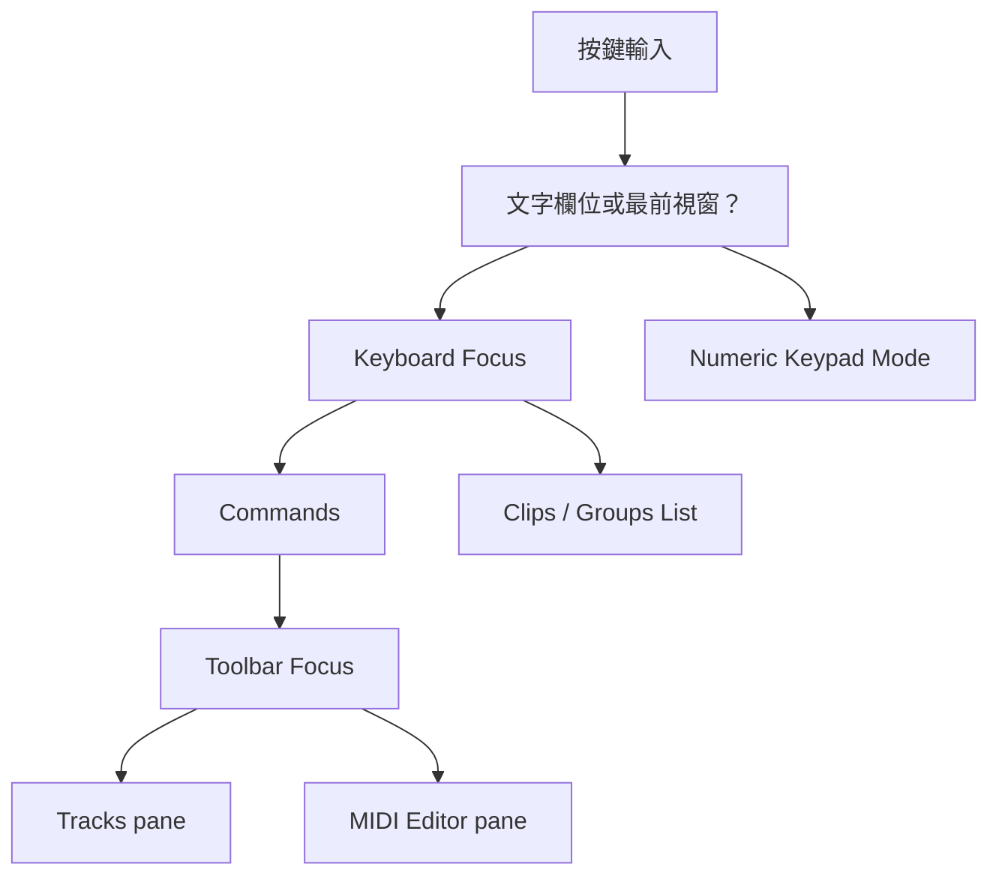
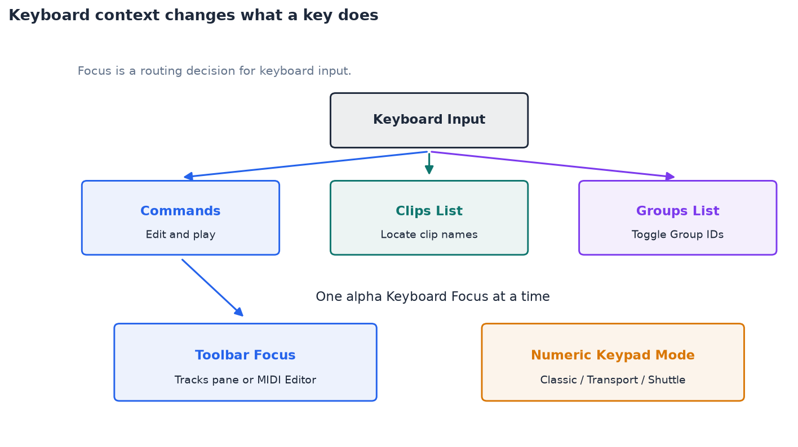

# Ch03 — 快捷鍵沒作用，先檢查 Keyboard Focus

> 快捷鍵的意思由焦點、所在視窗與 Numeric Keypad mode 一起決定，記住按鍵只是操作的一半。

原文：[Pro_Tools_Reference_Guide_2023.3.pdf#page=57](../notes/attachments/Pro_Tools_Reference_Guide_2023.3.pdf#page%3D57)，原書 p. 25–30（PDF p. 57–62）。功能與適用條件以 **2023.3** 為準；情境例子與圖解為本筆記重新組織的教學補充。

## 先理解 Modifier 的批次範圍

Pro Tools 的操作常用 modifier key 把一次動作擴大到整組對象。這比死背每一條快捷鍵更有用，但仍要看操作是否支援該規則。原書以 channel strip／Track 的 Automation、Playlist、Plug-In、Record Enable、Mute、Solo、I/O assignment 等功能為例。

| Mac 動作 | 原書說明的典型用途 | 使用前先確認 |
|---|---|---|
| Option + action | 對所有 channel strip／Track 套用 | 這個控制是否支援批次 |
| Option+Shift + action | 對選取的 channel strip／Track 套用 | Track Name 是否確實選取 |
| Command + 拖動控制 | Fine adjustment | 是旋鈕／Fader／breakpoint 等可微調控制 |
| Command+Shift + 調整 breakpoint | Grid mode 中更細微調整 | 正在改 Automation breakpoint |
| Option-click 列表項目 | 切換項目，其他設成相同新狀態 | 適用於該類 list／parameter selection |
| Command-click 列表項目 | 切換項目，其他設成相反狀態 | 不要套用到完全不同用途的按鈕 |

Scroll wheel 可以在已選取的數值欄位增減數值；Right-click 則提供情境 menu。先知道目前操作的是哪個欄位，才不會以為滑鼠滾輪永遠只控制畫面捲動。

> [!TIP] 實務連結
> 要把「選定的鼓軌」一起切換某項設定，先看選取範圍，再用 Option+Shift 的批次規則。若忘了 Shift 而操作支援 Option，可能影響整份 Session。

## Keyboard Focus：同一排字母鍵有三種工作

Keyboard Focus 決定 alpha keyboard 的單鍵輸入送去哪裡。三種 Focus 同時只能啟用一種；啟用新的，原來的就退出。各區的 `a–z` button 是最直接的視覺線索。

| Keyboard Focus | 字母鍵主要作用 | Mac 切換 |
|---|---|---|
| Commands | Edit／MIDI Editor 中的單鍵編輯與播放命令 | Command+Option+1 |
| Clips List | 依 Clip 名稱前幾個字母定位 | Command+Option+2 |
| Groups List | 以 Group ID 字母切換 Group | Command+Option+3 |

Commands Keyboard Focus 關閉時，仍可用 **Control + 該單鍵**存取這類命令。這裡是 Mac 的 Control，不能換成 Command。若同時開著多個 Plug-In window，即使它們具有自己的 focus，也只有最前面的視窗接到 keyboard input。

> [!WARNING] 操作前先離開文字輸入欄
> 正在改 Track Name、搜尋字串或數值時，字母鍵可能就是輸入文字。不要一邊打名稱，一邊期待它執行單鍵剪輯。

## Toolbar Focus：Edit window 裡也可能有兩套工具列

顯示 Docked MIDI Editor 後，Edit window 裡同時有 Tracks pane 與 MIDI Editor pane，各有 Toolbar／Timeline。Menu、Toolbar 與相關快捷鍵一次只對其中一套有焦點的區域作用，該 Toolbar 外框顯示黃色。若 Edit window 的 Keyboard Focus 已開啟，它會跟隨所選 Toolbar focus。

| 想操作的區域 | 直接操作 | Mac 快捷鍵 |
|---|---|---|
| Tracks pane | 點 Edit window 頂部 Toolbar | Command+Option+4 |
| MIDI Editor pane | 點 Docked MIDI Editor 上方 Toolbar | Command+Option+5 |

> [!TIP] 實務連結
> 在下方 Piano Roll 改了 Grid，卻發現上方 Audio 編輯沒有照想像移動，先檢查兩套 Toolbar 的焦點與設定。這種狀況應從視窗狀態排查，不必先懷疑快捷鍵壞掉。

## Numeric Keypad：Transport 與 Shuttle 不是同一套鍵位

到 `Setup > Preferences > Operation` 的 Transport 區設定 Numeric Keypad mode。這是右側獨立 Numeric Keypad，不要把主鍵盤數字列視為保證相同的輸入。

| Mode | 主要用途 | 重要差異 |
|---|---|---|
| Classic | 延續舊式 Shuttle Lock 操作 | Memory Location 用「編號、`.`」 |
| Transport | 常用播放／錄音控制加 Shuttle Lock | Memory Location 用「`.`、編號、`.`」 |
| Shuttle | 按住播放、放開停止的不同速度巡聽 | Ultimate only；不提供 Shuttle Lock |

Transport mode 下，Numeric Keypad 的 `0` 是 Play／Stop，`1` Rewind、`2` Fast Forward、`3` Record Enable，`4` Loop Playback、`5` Loop Record、`6` QuickPunch、`7` Click、`8` Countoff、`9` MIDI Merge／Replace。某些功能還有錄音狀態或版本條件，完整速查集中到 [PT-00-Mac快捷鍵](PT-00-Mac%E5%BF%AB%E6%8D%B7%E9%8D%B5.md)。

Classic／Transport 的 Shuttle Lock 可用 Mac `Control` 加 Numeric Keypad 1–9 進入不同速度：5 正常速度，6–9 更快前進，1–4 是不同反向速度；`+`／`−` 改方向，`0` 停住，Escape 或 Spacebar 離開。它是巡聽模式，不是一般音樂播放的全功能替代。

## 不知道命令在哪裡，用 Pro Tools Search

1. 選 `Window > Pro Tools Search`，或按 **Control+Shift+S**。
2. 輸入 command 或 object 名稱；匹配項目會即時列出。
3. 用 Up／Down 選擇，再按 Return；也可直接點選結果。

Search 不只找 menu command，也能找 Track、Clip、Memory Location、Track Group 與 AudioSuite Plug-In。結果的動作隨類型不同：可能執行命令、選取物件、叫回位置、切換 Group 或打開 Plug-In。

> [!NOTE] Takeaway
> 「沒反應」的檢查順序是：文字欄位與最前視窗 → Commands／Clips／Groups Focus → Tracks／MIDI Toolbar focus → Numeric Keypad mode。完整按鍵表留在專頁，這章負責讓你知道那些鍵什麼時候才成立。

圖解讀法：此圖是原創概念示意，位置、比例與箭頭僅表達本章關係；不代表軟體畫面或實測效能。

## 相關

上一篇：[PT-Ch02b-時間基準資源與交換格式](PT-Ch02b-%E6%99%82%E9%96%93%E5%9F%BA%E6%BA%96%E8%B3%87%E6%BA%90%E8%88%87%E4%BA%A4%E6%8F%9B%E6%A0%BC%E5%BC%8F.md)

下一篇：[PT-Ch04-用Help找準確答案](PT-Ch04-%E7%94%A8Help%E6%89%BE%E6%BA%96%E7%A2%BA%E7%AD%94%E6%A1%88.md)

按任務閱讀：[PT-00-工作流程導航](PT-00-%E5%B7%A5%E4%BD%9C%E6%B5%81%E7%A8%8B%E5%B0%8E%E8%88%AA.md)

[PT-Ch12a-主要視窗與Transport](PT-Ch12a-%E4%B8%BB%E8%A6%81%E8%A6%96%E7%AA%97%E8%88%87Transport.md) · [PT-Ch08a-顯示與錄音操作偏好](PT-Ch08a-%E9%A1%AF%E7%A4%BA%E8%88%87%E9%8C%84%E9%9F%B3%E6%93%8D%E4%BD%9C%E5%81%8F%E5%A5%BD.md)

[PT-00-索引](PT-00-%E7%B4%A2%E5%BC%95.md) · [PT-00-功能目錄](PT-00-%E5%8A%9F%E8%83%BD%E7%9B%AE%E9%8C%84.md) · [PT-00-快速檢索](PT-00-%E5%BF%AB%E9%80%9F%E6%AA%A2%E7%B4%A2.md) · [PT-00-Mac快捷鍵](PT-00-Mac%E5%BF%AB%E6%8D%B7%E9%8D%B5.md)

標籤： #pro-tools #audio #study-note
