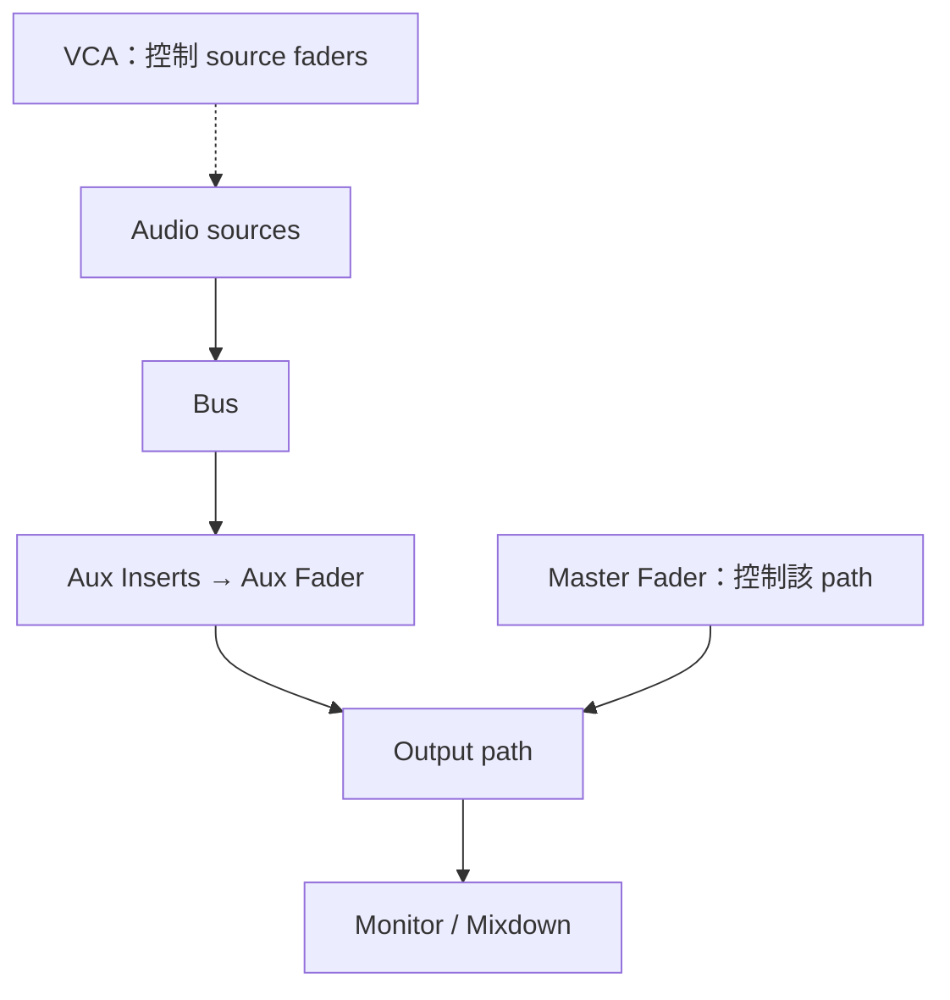

# Ch50a — 混音Track與訊號流

> Audio、Aux、Master Fader 與 VCA 都能改變混音，卻只有先看清楚訊號是否真的流過它們，才不會接錯。

原文：[Chapter 50，原書 p. 1095–1105／PDF p. 1127–1137](../notes/attachments/Pro_Tools_Reference_Guide_2023.3.pdf#page%3D1127)。內容依 **2023.3** 文件消化重組；下文未標為原書數值的練習情境與圖解均為筆記補充。

## 混音先是 routing 問題，才是 Fader 問題

Mixing 的基本單位包括 input、output、bus、insert、send。音量平衡、Pan 與效果建立在正確路由之上。原書也強調用不同 speakers、聆聽環境與格式檢查 mix translation；一個在自己房間好聽的混音，不代表 Mono playback 或其他系統一定沒有問題。

| Track type | 是否通過 Audio | 主要來源／用途 | Insert 相對 Fader |
|---|---|---|---|
| Audio | 是 | 磁碟播放、錄音與 input monitoring | Pre-fader |
| Auxiliary Input | 是 | Hardware input／internal bus，submix 或 effect return | Pre-fader |
| Routing Folder | 是 | 與 Aux 相同的路由功能，加上收納管理 | Pre-fader |
| Instrument | 是；也有 MIDI | Instrument Plug-In 或外部音源 Audio | Pre-fader |
| Master Fader | 控制所指派 bus／output path | 該路徑整體 level 與 post-fader 處理 | Post-fader |
| MIDI | 不通 Audio | MIDI 事件與輸出控制 | 不適用 Audio Insert |
| VCA Master | 不通 Audio／MIDI | 透過 Mix Group 控制成員 | 無 Insert、Send、I/O |

最重要的差異是 Master Fader 的 Insert 在 Fader 之後，而一般 Audio／Aux／Instrument 的 Insert 在前面。若 Compressor 放 Master Fader，主 Fader fade out 會連 Compressor 的輸入一起變小；若想保留原壓縮行為，用 Aux 做 mix processing，再由後面的 Master Fader 做最終淡出與 dither，路由邏輯較清楚。

> [!TIP] 實務連結
> 需要鼓組 bus compression，讓各鼓 Track output 進 Drum Aux；需要把整套鼓平衡暫時抬高、但仍保持各軌的獨立 routing，可用 VCA。VCA 不能拿來插 bus Compressor，因為聲音根本沒有流過它。

## Master Fader 控制的是路徑，不是另外多混一條 Audio

Master Fader 直接對指定 bus／output path 提供 level 與處理；不提供 sends、Pan、Mute、Solo。原書指出它不消耗一般 Audio Track 的處理能力，同一路徑不能指派多個 Master Fader。複製 Master Fader 時，新複本的 assignment 會 inactive，避免兩個一起控制同一個路徑。

例如各 source output 都進 Bus Drum，Aux input 也選 Bus Drum；若要先減少進 Aux 的總訊號，可在該 bus 指派 Master Fader。它並不是 Audio 再串接一次到另一個 input，而是控制同一條 bus 的總量。

| 想做的事 | 合適結構 | 核對點 |
|---|---|---|
| 一起處理多軌音色 | Source outputs → bus → Aux | 所有 source 是否都真的經過 Aux |
| 控制整個 output path | Master Fader 指派該 path | channel width 與路徑正確 |
| 暫時調一組 source 控制值 | VCA + Mix Group | 成員是否正確、是否含自己 |
| 控制外部 synth | Instrument 的 MIDI 與 Audio 兩套 routing | MIDI 有送出不代表 Audio 已接回 |

## VCA 直接改成員控制，不是改一份合成訊號

將 Mix 或 Mix/Edit Group 指派給 VCA Master，一次只能指派一個 Group，不能包含 VCA 自己。成員的 Volume fader 顯示實際 composite position；同一 Track 可同時屬多個 VCA group，其控制貢獻一起作用。MIDI Track 的 MIDI volume fader 不由 VCA volume 一樣地控制，但 mute 等行為另有支援。

VCA meter 顯示成員裡的最高 level，**不是把所有成員加總的 bus level**。成員 channel format 相同時按該格式顯示，混合格式則顯示單一 meter。看這個 meter 不能據此推算實際 submix peak。

| VCA 控制 | 基本效果 | 需要注意 |
|---|---|---|
| Volume | 改成員 Audio-related Volume | 不等同 Audio summing bus |
| Mute | 使成員 implicit mute | 不抹掉原本各成員明確 mute 狀態 |
| Solo | 以成員為 solo 範圍 | 成員 explicit solo 可改變聆聽狀態 |
| Record Enable／TrackInput | 控制符合原本 armed 條件的成員 | Option-click 可強制套到所有成員 |

預設 Standard VCA Logic for Group Attributes 會讓 VCA 成員可獨立調整，而不是同時再服從所有 Mix Group 連動。如果確實想讓兩種規則共存，再到 Mixing preferences 修改，不要因看見成員沒一起動，就立刻判定 VCA 沒作用。

## Stereo Pan Depth 是 center attenuation

Pan Depth 在 Session Setup 設定，控制 Mono signal panned center 到 Stereo output 時的衰減。原書選項 −2.5、−3.0、−4.5、−6.0 dB；新 Session 的預設說明為 −3.0 dB，較早版本相容使用 −2.5 dB，greater-than-stereo 的 surround panning 則固定 −3.0 dB。

> [!WARNING] 改 Pan Depth 可能改變混音平衡
> 它不是「更寬」的任意特效參數；center 與左右端點的相對 level 變了，原來的 Fader balance 可能不再相同。比較兩份 Session 聲音不一致時，除了 Plug-In，也要檢查 Pan Depth。

> [!NOTE] Takeaway
> Aux 是音訊路徑，Master Fader 控制路徑，VCA 控制成員。一般 Insert 在 Fader 前，Master Insert 在後；這會改變 Compressor 與 fade out 的關係。先確認路由，再解釋音量差異。

## 相關

上一篇：[PT-Ch49-HEAT的音色與資源管理](PT-Ch49-HEAT%E7%9A%84%E9%9F%B3%E8%89%B2%E8%88%87%E8%B3%87%E6%BA%90%E7%AE%A1%E7%90%86.md)

下一篇：[PT-Ch50b-Sends與混音視窗操作](PT-Ch50b-Sends%E8%88%87%E6%B7%B7%E9%9F%B3%E8%A6%96%E7%AA%97%E6%93%8D%E4%BD%9C.md)

按任務閱讀：[PT-00-工作流程導航](PT-00-%E5%B7%A5%E4%BD%9C%E6%B5%81%E7%A8%8B%E5%B0%8E%E8%88%AA.md)

同章分篇：[PT-Ch50b-Sends與混音視窗操作](PT-Ch50b-Sends%E8%88%87%E6%B7%B7%E9%9F%B3%E8%A6%96%E7%AA%97%E6%93%8D%E4%BD%9C.md) · [PT-Ch50c-Submix效果回傳與耳機混音](PT-Ch50c-Submix%E6%95%88%E6%9E%9C%E5%9B%9E%E5%82%B3%E8%88%87%E8%80%B3%E6%A9%9F%E6%B7%B7%E9%9F%B3.md) · [PT-Ch50d-DelayCompensation與Dither](PT-Ch50d-DelayCompensation%E8%88%87Dither.md)

跨章延伸：[PT-Ch51a-PlugInInsert與SideChain](PT-Ch51a-PlugInInsert%E8%88%87SideChain.md) · [PT-Ch53a-Automation模式與資料層](PT-Ch53a-Automation%E6%A8%A1%E5%BC%8F%E8%88%87%E8%B3%87%E6%96%99%E5%B1%A4.md)

[PT-00-索引](PT-00-%E7%B4%A2%E5%BC%95.md) · [PT-00-快速檢索](PT-00-%E5%BF%AB%E9%80%9F%E6%AA%A2%E7%B4%A2.md) · [PT-00-功能目錄](PT-00-%E5%8A%9F%E8%83%BD%E7%9B%AE%E9%8C%84.md) · [PT-00-Mac快捷鍵](PT-00-Mac%E5%BF%AB%E6%8D%B7%E9%8D%B5.md)

標籤： #pro-tools #audio #workflow
