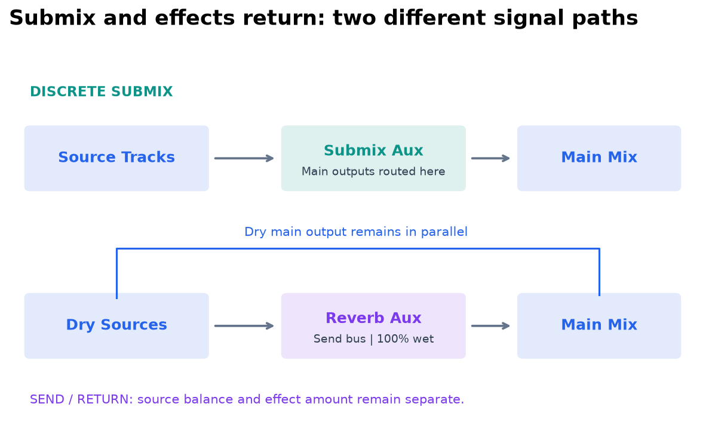

# Ch50b — Sends與混音視窗操作

> Send 把訊號分出去，卻不會自動替你建立回程；聲音在哪裡消失，沿著來源、Send、目的地三段查最有效。

原文：[Chapter 50，原書 p. 1106–1127／PDF p. 1138–1159](../notes/attachments/Pro_Tools_Reference_Guide_2023.3.pdf#page%3D1138)。內容依 **2023.3** 文件消化重組；下文未標為原書數值的練習情境與圖解均為筆記補充。

## 把常用欄位顯示出來，再談快速操作

Edit／Mix window 都能按需顯示 Comments、Instrument controls、Inserts A–E／F–J、Sends A–E／F–J 等。EQ Curve view 只在 Mix window，對支援的 EQ 顯示曲線；同一 Track 多個 EQ 時可顯示其合成曲線。並非所有 third-party Plug-In 提供曲線，所以有 EQ indicator、沒曲線不一定是故障。

| 顯示方式 | 看得到什麼 | 適合工作 |
|---|---|---|
| Sends Assignments | 五個 Send assignment 名稱 | 看整體 routing |
| Expanded Sends | 某些 Send 的 level、Pan、Mute | 直接調 cue mix／effect send |
| Send window | 單一 Send 的完整控制 | 把重要 Send 固定留在畫面 |
| Path Meter View | 所選 path 的 level | 區分單軌 Send 與整個 bus |

Command-click Send selector 切換 expanded view；Shift-click 可以開額外的 Output／Send window。Target 關閉讓視窗保留，不被下一個視窗取代。這在大 Session 做耳機混音很方便，不必一直捲回特定 Track。

## 建立 Send 後，還要有返回或目的輸出

每條 Audio、Aux、Routing Folder、Instrument Track 可有 A–J 十個 Sends。它可以指向 internal bus 或 hardware output。Internal Send 若要在主混音聽到，需要 Aux／Audio／Instrument Track 接收後再輸出；external send 則要看外部設備與回程。這與 Hardware Insert 的自動 send-and-return 結構不同。

1. 顯示 Sends view，點空 Send selector 選 bus／output。
2. 打開 Send window，確認 level 不是 −INF；Option-click fader 回 unity。
3. 依需求選 PRE 或 post-fader。
4. 目的地若是 internal effect bus，建立 Aux 並讓 input 接同一條 bus。
5. 確認 Aux output 到正確 main mix；effect return 應避免重複混入不必要 dry signal。

| PRE／Post | 主 Fader 改變後 | 常見用途 |
|---|---|---|
| Pre-fader | Send 不跟隨主 Fader level | 獨立耳機平衡、某些特殊處理 |
| Post-fader | Send 跟隨主 Fader level | Reverb／Delay 隨 source level 維持比例 |
| FMP | Send Pan 跟 Main Pan | 需要一致空間位置 |
| FMP 關閉 | Send Pan 可獨立 | 不同 cue mix 或空間設計 |

> [!TIP] 實務連結
> 歌手希望耳機裡自己更大聲，不一定要動主混音 Fader。用獨立 Send 調 headphone mix，才能讓 control room 的平衡維持。若用 post-fader 作快速複製主混音，之後主 Fader 改動仍會影響歌手，需要清楚這個取捨。

## Send assignment、copy 與狀態

Send selector 可以直接 `New Track`，自動建立 Aux／Audio／Instrument 與可用 bus；也可選 Track submenu，接到合格的既有接收 Track。名稱會用於新 Track 與 bus，因此建立時用能辨認目的的名稱，比一直用 Bus 17–18 更好查。

| 操作 | Mac | 保留／影響 |
|---|---|---|
| 複製 Send | Option-drag 到新 slot | routing、automation、level／Pan／Mute 一起帶走 |
| 搬 Send | 直接拖 | 換 slot 或換 Track |
| Send inactive | Command+Control-click assignment | 保留資料，釋放相應 routing 資源 |
| 所選 Track 全部 Send mute | Shift+Q | 不是 Track Mute |
| 所選 Track 的 A–E／F–J mute | Shift+4／Shift+5 | 分別控制兩組 Send |

> [!WARNING] 不同 channel width 之間 copy Send，Pan automation 可能掉資料
> 例如 Stereo Send 從 Mono Track 複製到 Stereo Track，原書列有 Pan automation 被移除的情況。覆蓋既有 Send 也會替換其 automation。快速拖放之前，先確認目的是複製路由模板，還是保留既有時間變化。

Send assignment 顏色與文字也有意義：Mute 時按鈕藍色，clipping 文字紅色，window 開啟則亮起；Pre-fader 在相應顯示中也有藍色提示，因此判讀要看是哪個區域，不能只說「藍色一定是靜音」。Send metering 只顯示 post-send-fader level；可以開啟 assignment level meter，或 Option+C 清除全部 Clip indicators。

## Multiple Outputs 與 No Output

Track output 可 Control-click 加上多個 assignment，適合相同 mix 同時送不同硬體輸出。`+` 表示多個 output，`*` 表示其中有 inactive。這與各自可調 Send level 的獨立混音不同，別為了做不同耳機平衡只加相同 output copy。

No Output 會讓該 Track main output 不可聽，原書還提醒可能失去相關 Pan automation；它不自動釋放 Plug-In DSP。想省資源，要處理 Track／Plug-In 的 active 狀態，而不只是斷 main output。

| 查 routing 的右鍵命令 | 結果 |
|---|---|
| Select Assignments To | 選出使用相同路徑的 Track |
| Show Assignments To | 顯示相關 Track，也保留其他 Track |
| Show Only Assignments To | 只看相關 Track，隱藏其他 |
| Restore Previously Shown Tracks | 回到剛才的顯示狀態 |

這些 Bus Interrogation 工具可以從 Input、Output、Send、Hardware Insert assignment 存取。大工程想知道「誰還在送這條 Reverb」，用它比逐一讀 Send 名稱快。

> [!NOTE] Takeaway
> Send 需要目的地，PRE／Post 決定是否跟 Fader，FMP 決定是否跟 Pan。複製 Send 會攜帶 routing 與 automation，換 width 要重新檢查；No Output 也不等於省資源。查大工程 routing，善用 Bus Interrogation。

## 相關

上一篇：[PT-Ch50a-混音Track與訊號流](PT-Ch50a-%E6%B7%B7%E9%9F%B3Track%E8%88%87%E8%A8%8A%E8%99%9F%E6%B5%81.md)

下一篇：[PT-Ch50c-Submix效果回傳與耳機混音](PT-Ch50c-Submix%E6%95%88%E6%9E%9C%E5%9B%9E%E5%82%B3%E8%88%87%E8%80%B3%E6%A9%9F%E6%B7%B7%E9%9F%B3.md)

按任務閱讀：[PT-00-工作流程導航](PT-00-%E5%B7%A5%E4%BD%9C%E6%B5%81%E7%A8%8B%E5%B0%8E%E8%88%AA.md)

同章分篇：[PT-Ch50a-混音Track與訊號流](PT-Ch50a-%E6%B7%B7%E9%9F%B3Track%E8%88%87%E8%A8%8A%E8%99%9F%E6%B5%81.md) · [PT-Ch50c-Submix效果回傳與耳機混音](PT-Ch50c-Submix%E6%95%88%E6%9E%9C%E5%9B%9E%E5%82%B3%E8%88%87%E8%80%B3%E6%A9%9F%E6%B7%B7%E9%9F%B3.md) · [PT-Ch50d-DelayCompensation與Dither](PT-Ch50d-DelayCompensation%E8%88%87Dither.md)

跨章延伸：[PT-Ch51a-PlugInInsert與SideChain](PT-Ch51a-PlugInInsert%E8%88%87SideChain.md) · [PT-Ch53a-Automation模式與資料層](PT-Ch53a-Automation%E6%A8%A1%E5%BC%8F%E8%88%87%E8%B3%87%E6%96%99%E5%B1%A4.md)

[PT-00-索引](PT-00-%E7%B4%A2%E5%BC%95.md) · [PT-00-快速檢索](PT-00-%E5%BF%AB%E9%80%9F%E6%AA%A2%E7%B4%A2.md) · [PT-00-功能目錄](PT-00-%E5%8A%9F%E8%83%BD%E7%9B%AE%E9%8C%84.md) · [PT-00-Mac快捷鍵](PT-00-Mac%E5%BF%AB%E6%8D%B7%E9%8D%B5.md)

標籤： #pro-tools #audio #workflow
